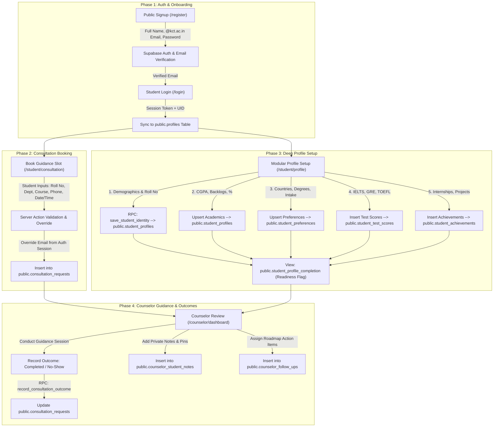

# K-GEO Platform: End-to-End Data Flow & Lifecycle Analysis

This document provides a comprehensive structural and systematic analysis of the **K-GEO Higher-Studies Guidance Platform** (`D:/kgeo/web/K-GEO`). It details the end-to-end lifecycle of student and counselor data—specifically explaining why minimal data is requested during login while extensive details are gathered during consultation booking and profile onboarding, where every piece of data is stored in PostgreSQL, when it is collected, and how server-side integrity is enforced.

---

## 1. Executive Summary & Architectural Design

K-GEO is a vertical higher-studies guidance platform built for Kumaraguru College of Technology (KCT) students and counseling staff. The application is built upon a modern TypeScript stack designed for strict data integrity and role separation:
* **Frontend / Server Framework**: Next.js 16 (App Router) with React 19 and Tailwind CSS v4.
* **Validation Layer**: Strict schema validation using Zod ([auth.ts](file:///D:/kgeo/web/K-GEO/src/lib/validation/auth.ts), [consultation.ts](file:///D:/kgeo/web/K-GEO/src/lib/validation/consultation.ts), [student-profile.ts](file:///D:/kgeo/web/K-GEO/src/lib/validation/student-profile.ts)).
* **Database & Authentication**: Supabase Auth (PostgreSQL) with Row Level Security (RLS).
* **Role Hierarchy**: Four distinct user roles: `student`, `counselor`, `admin`, and `director` ([index.ts](file:///D:/kgeo/web/K-GEO/src/types/index.ts)).

### Why Minimal Login vs. Extensive Consultation Data?
1. **Low Friction at Entry**: During registration and login, K-GEO requires *only* the student's institutional email address (`@kct.ac.in`) and a dedicated K-GEO password. This removes onboarding friction, ensures only verified Kumaraguru students can access the portal, and avoids storing sensitive external credentials (like Microsoft/Outlook portal passwords).
2. **Context-Driven Deep Data Collection**: When a student requests a consultation or prepares for counseling, the counselor needs comprehensive academic, demographic, and preference data to provide tailored guidance. K-GEO gathers this structured data progressively across consultation booking and modular profile onboarding sections.

---

## 2. End-to-End Data Lifecycle Workflow

The following diagram illustrates the chronological progression of data collection, validation, and storage across the student and counselor journeys:

---

## 3. Systematic Data Collection Inventory by Phase

### Phase 1: Student Registration & Authentication
* **When Collected**: Initial account creation and subsequent login sessions.
* **Primary Source Files**: [auth.ts (Validation)](file:///D:/kgeo/web/K-GEO/src/lib/validation/auth.ts), [auth-actions.ts (Server Actions)](file:///D:/kgeo/web/K-GEO/src/app/actions/auth-actions.ts).

| Field Name | Data Type & Validation Rule | When Collected | Storage Table & Column | Notes / Security Rules |
| :--- | :--- | :--- | :--- | :--- |
| **Full Name** | Text (2–150 chars, canonical format) | Registration | `public.profiles.full_name` & `auth.users.raw_user_meta_data` | Normalized to uppercase/canonical format via `canonicalFullNameSchema`. |
| **College Email** | Text (Must end in exact domain `@kct.ac.in`) | Registration & Login | `auth.users.email` & `public.profiles.college_email` | Case-insensitive. Strictly enforced by `institutionalEmailSchema`. |
| **Password** | Text (Min 8 chars, >=1 letter, >=1 number) | Registration & Login | `auth.users.encrypted_password` | Dedicated K-GEO password. College Microsoft/Outlook passwords are **never** requested or stored. |
| **Terms Accepted** | Literal string (`"accepted"`) | Registration | *Not stored in DB* | Verified in-memory during submission to ensure legal compliance. |
| **Role & Status** | Enum (`user_role`) & Boolean | Server Derived | `public.profiles.role` & `public.profiles.is_active` | Defaults to `'student'` and `is_active = true` upon signup. |

---

### Phase 2: Guidance Consultation Booking
* **When Collected**: When a student schedules an initial or follow-up consultation slot with a guidance counselor.
* **Primary Source Files**: [consultation.ts (Validation)](file:///D:/kgeo/web/K-GEO/src/lib/validation/consultation.ts), [consultation-actions.ts (Server Action)](file:///D:/kgeo/web/K-GEO/src/app/actions/consultation-actions.ts).

> [!IMPORTANT]
> **Server-Side Trust Rule**: In consultation requests, the student's `college_email` and `student_id` are **never** trusted from the HTML form submission. The server action automatically injects these values directly from the authenticated Supabase session to prevent identity spoofing.

| Field Name | Data Type & Validation Rule | When Collected | Storage Table & Column | Source & Derivation |
| :--- | :--- | :--- | :--- | :--- |
| **Student ID** | UUID | Consultation Booking | `public.consultation_requests.student_id` | **Server Derived** from `auth.uid()`. |
| **Request Number** | Text (Unique alphanumeric ID) | Consultation Booking | `public.consultation_requests.request_number` | **Server Generated** sequence reference. |
| **Student Name** | Text (2–150 chars) | Consultation Booking | `public.consultation_requests.student_name` | User entered / pre-filled from profile. |
| **Roll Number** | Text (Uppercase, 1–50 chars) | Consultation Booking | `public.consultation_requests.roll_number` | User entered / pre-filled (e.g., `717821CS101`). |
| **College Email** | Text (`@kct.ac.in`) | Consultation Booking | `public.consultation_requests.college_email` | **Server Overridden** from auth session profile. |
| **Personal Email** | Text (Valid email format) | Consultation Booking | `public.consultation_requests.personal_email` | Student entered for external correspondence. |
| **College End Year**| Integer (Allowed graduation year) | Consultation Booking | `public.consultation_requests.college_end_year` | Validated against supported academic years. |
| **Course** | Text (Supported degree course) | Consultation Booking | `public.consultation_requests.course` | E.g., `B.E.`, `B.Tech`, `M.E.`, `MBA`. |
| **Department** | Text (Department mapped to course) | Consultation Booking | `public.consultation_requests.department` | Must match valid course-department pairings. |
| **Mobile Number** | Text (Exactly 10 digits) | Consultation Booking | `public.consultation_requests.mobile_number` | Numeric string validation. |
| **Studies Interest**| Enum (`interested`, `exploring`, `not_interested`)| Consultation Booking | `public.consultation_requests.higher_studies_interest`| Core screening metric for counselors. |
| **Consultation Date**| Date string (`YYYY-MM-DD`) | Consultation Booking | `public.consultation_requests.consultation_date` | Validated against Asia/Kolkata business calendar. |
| **Slot Start Time** | Time string (e.g., `"10:00"`) | Consultation Booking | `public.consultation_requests.slot_start` | Checked against active counselor availability. |
| **Slot End Time** | Time string (e.g., `"10:30"`) | Consultation Booking | `public.consultation_requests.slot_end` | **Server Derived** (strictly 30-minute duration). |
| **Booking Status** | Enum (`consultation_status`) | Consultation Booking | `public.consultation_requests.status` | Defaults to `'scheduled'` upon creation. |

---

### Phase 3: Comprehensive Student Profile Setup (Onboarding)
To prepare for deep counseling, students complete a 5-part profile in `/student/profile`. This data provides counselors with a 360-degree view of the student's academic standing, study abroad goals, exam readiness, and extracurricular achievements.
* **Primary Source Files**: [student-profile.ts](file:///D:/kgeo/web/K-GEO/src/lib/validation/student-profile.ts), [student-optional-records.ts](file:///D:/kgeo/web/K-GEO/src/lib/validation/student-optional-records.ts), [profile-actions.ts](file:///D:/kgeo/web/K-GEO/src/app/actions/profile-actions.ts).

#### 1. Identity & Academic Status (`public.student_profiles`)
* **When Collected**: During initial profile onboarding or profile updates.
* **Storage Method**: Atomically saved via PostgreSQL RPC function `save_student_identity` and upserts to `student_profiles`.

| Field Name | Data Type & Validation | Storage Column (`public.student_profiles`) | Description & Validation Highlights |
| :--- | :--- | :--- | :--- |
| **Roll Number** | Text (Uppercase, max 50 chars) | `roll_number` | Primary institutional student identifier. |
| **Personal Email** | Text (Valid email, max 320 chars) | `personal_email` | Secondary contact address. |
| **Mobile Number** | Text (10 digits) | `mobile_number` | Primary SMS/WhatsApp contact number. |
| **College Name** | Text (Supported college name) | `college` | Validated against supported KCT institutions. |
| **Course & Dept** | Text (Valid course & department) | `course` / `department` | Cross-validated to ensure department exists under course. |
| **Current Year** | Integer (1–8, nullable) | `current_year` | Current academic year of study. |
| **Current Semester**| Integer (1–16, nullable) | `current_semester` | Must match selected academic year range (`(Year-1)*2+1` to `Year*2`). |
| **Graduation Year** | Integer (2024–2040) | `graduation_year` | Expected year of degree completion. |
| **CGPA & Scale** | Decimal & Enum (`4` or `10`) | `cgpa` / `cgpa_scale` | CGPA cannot exceed selected scale. Can flag as `cgpa_unavailable`. |
| **Backlogs** | Integer (0–100) | `active_backlogs` / `cleared_backlogs` | Track active academic arrear counts and historical cleared counts. |
| **Prior Percentages**| Decimal (0–100, nullable) | `sslc_percentage`, `hsc_percentage`, `diploma_percentage`| Academic performance in 10th (SSLC), 12th (HSC), or Diploma. |
| **Academic Remarks**| Text (Max 2,000 chars, nullable)| `academic_remarks` | Additional student-provided context regarding academic performance. |

#### 2. Higher-Studies Preferences (`public.student_preferences`)
* **When Collected**: Preference section of profile onboarding.
* **Storage Method**: One-to-one relation table keyed by `student_id`.

| Field Name | Data Type & Options | Storage Column (`public.student_preferences`) | Description & Rules |
| :--- | :--- | :--- | :--- |
| **Studies Interest** | Enum (`interested`, `exploring`, `not_interested`) | `higher_studies_interest` | Core ambition metric. |
| **Study Level** | Enum (`masters`, `postgraduate_diploma`, `mba`, `phd`, `other`) | `preferred_study_level` | Target degree type. |
| **Target Countries**| Text Array (Max 10 items, 80 chars each) | `preferred_countries` | Normalized and deduplicated array of target study destinations. |
| **Program Areas** | Text Array (Max 10 items, 120 chars each) | `preferred_program_areas` | Deduplicated list of academic fields/majors of interest. |
| **Target Intake** | Text (`"Season-Year"`, e.g., `"Fall-2026"`) | `target_intake` | Transformed from separate `targetSeason` and `targetYear` inputs. |
| **Budget & Funding**| Text (Max 100 chars) & Booleans | `budget_range`, `scholarship_required`, `funding_required`| Financial planning parameters and scholarship dependency flags. |
| **Study Mode** | Enum (`full_time`, `part_time`, `either`) | `study_mode` | Mode of attendance preference. |
| **Academic Pref** | Enum (`coursework`, `research`, `either`, `undecided`) | `academic_preference` | Orientation toward research thesis vs. coursework-based degrees. |
| **Planning Stage** | Enum (`exploring`, `preparing_exams`, `shortlisting`, etc.) | `student_planning_stage` | Current self-reported progress along the application roadmap. |

#### 3. Entrance Exams & Test Scores (`public.student_test_scores`)
* **When Collected**: Optional section during profile setup; students can add multiple attempts.
* **Storage Method**: One-to-many table (`student_test_scores`), each row representing an exam attempt.

| Field Name | Data Type & Validation | Storage Column (`public.student_test_scores`) | Validation Highlights |
| :--- | :--- | :--- | :--- |
| **Exam Name** | Enum (`ielts`, `toefl`, `pte`, `gre`, `gmat`, `gate`, `other`) | `exam_name` | Standardized study-abroad entrance examinations. |
| **Custom Name** | Text (Max 100 chars, uppercase) | `custom_exam_name` | Required if and only if `examName === "other"`. |
| **Exam Status** | Enum (`not_planned`, `planning`, `booked`, `completed`, `not_required`) | `exam_status` | Governs which date and score fields are permitted. |
| **Attempt Number**| Integer (1–20) | `attempt_number` | Tracks sequential test attempts. |
| **Planned Date** | Date string (`YYYY-MM-DD`) | `planned_date` | Required if status is `'booked'`. |
| **Completed Date**| Date string (`YYYY-MM-DD`) | `completed_date` | Required if status is `'completed'`. Cannot be in the future. |
| **Score & Validity**| Text (Max 100 chars) & Date string | `score` / `valid_until` | Allowed only for `'completed'` exams. `valid_until` >= `completed_date`. |

#### 4. Extracurricular Achievements & Experience (`public.student_achievements`)
* **When Collected**: Optional section during profile setup to record holistic profile strength.
* **Storage Method**: One-to-many table (`student_achievements`), each row representing an experience or award.
* **Fields**: `achievement_type` (Enum: `internship`, `project`, `research`, `publication`, `award`, `work_experience`, etc.), `title` (Max 200 chars), `organization` (Max 200 chars), `achievement_date` (Date <= today), `description` (Max 2,000 chars).

#### 5. Profile Readiness Calculation (`public.student_profile_completion` View)
The database automatically aggregates the student's profile sections into a dynamic SQL view (`student_profile_completion`). It calculates:
* `essential_fields_completed` & `overall_completion_percentage`.
* `ready_for_counseling`: A boolean flag indicating whether the student has completed sufficient data to be counseled effectively.

---

### Phase 4: Counselor Guidance, Outcomes & Private Records
* **When Collected**: When counselors review student profiles in the directory (`/counselor/students`), conduct scheduled sessions, or assign follow-up action items.
* **Primary Source Files**: [counselor-private-records.ts](file:///D:/kgeo/web/K-GEO/src/lib/validation/counselor-private-records.ts), [consultation-outcome-actions.ts](file:///D:/kgeo/web/K-GEO/src/app/actions/consultation-outcome-actions.ts), [counselor-private-record-actions.ts](file:///D:/kgeo/web/K-GEO/src/app/actions/counselor-private-record-actions.ts).

> [!CAUTION]
> **Student Privacy & RLS Enforcement**: Counselor Private Notes (`counselor_student_notes`) and Follow-up Workloads (`counselor_follow_ups`) are strictly isolated by Row Level Security. Students **cannot** read, query, or access counselor notes or internal follow-up records under any circumstances.

#### 1. Consultation Outcome Recording
* **When Collected**: Immediatley after a consultation slot concludes.
* **Storage Method**: Executed via PostgreSQL RPC function `record_consultation_outcome` targeting `consultation_requests`.

| Field Name | Data Type & Values | Storage Column (`public.consultation_requests`) | Automated Server Actions |
| :--- | :--- | :--- | :--- |
| **Outcome Status** | Enum (`completed`, `no_show`) | `status` | Updates the consultation status from `'scheduled'` to final outcome. |
| **Recorded At** | Timestamp | `outcome_recorded_at` | Automatically stamped with current server time (`now()`). |
| **Recorded By** | UUID | `outcome_recorded_by` | Automatically stamped with the authenticated counselor's user ID (`auth.uid()`). |

#### 2. Counselor Private Notes (`public.counselor_student_notes`)
* **When Collected**: Written by counselors during or after student interactions.
* **Fields**:
  * `student_id` (UUID): Target student being evaluated.
  * `consultation_id` (UUID, optional): Links note to a specific consultation session.
  * `note_text` (Text, max 5,000 chars): Detailed private observations, evaluation of student goals, or guidance summary.
  * `is_pinned` (Boolean): Flag to highlight critical notes at the top of the student's directory profile.
  * `counselor_id` (UUID): Auto-attached author ID (`auth.uid()`).

#### 3. Counselor Follow-up Tasks & Workload (`public.counselor_follow_ups`)
* **When Collected**: Assigned by counselors to track future student deliverables or check-ins.
* **Fields**:
  * `student_id` & `counselor_id` (UUIDs).
  * `due_date` (Date string >= `2000-01-01`): Target date for the follow-up action.
  * `priority` (Enum: `low`, `normal`, `high`): Task urgency.
  * `next_action` (Text, max 500 chars): Concise summary of the next required step (e.g., "Verify SOP draft" or "Check IELTS booking").
  * `details` (Text, max 2,000 chars): Comprehensive instructions or background context.
  * `status` (Enum: `pending`, `completed`, `cancelled`): Managed via RPC `record_counselor_follow_up_status`. Stamped with `completed_at` and `completed_by`.

---

## 4. Comprehensive Database Schema Matrix

The following matrix maps every data entity in the K-GEO platform to its PostgreSQL table, primary key, foreign key relationships, and associated RPC functions ([database.ts](file:///D:/kgeo/web/K-GEO/src/types/database.ts)):

| Entity / Domain | PostgreSQL Table / View | Primary Key | Foreign Keys / References | Associated RPCs / Database Functions |
| :--- | :--- | :--- | :--- | :--- |
| **User Profiles** | `public.profiles` | `id` (UUID) | References `auth.users(id)` | Triggered on auth signup; queried for role navigation. |
| **Consultations** | `public.consultation_requests` | `id` (UUID) | `student_id` -> `profiles(id)` `assigned_counselor_id` -> `profiles(id)` | `get_consultation_slot_availability` `record_consultation_outcome` `get_counselor_consultation_references` |
| **Student Identity** | `public.student_profiles` | `student_id` | `student_id` -> `profiles(id)` | `save_student_identity` |
| **Study Preferences**| `public.student_preferences` | `student_id` | `student_id` -> `profiles(id)` | Directly upserted via Supabase client. |
| **Test Scores** | `public.student_test_scores` | `id` (UUID) | `student_id` -> `profiles(id)` | Managed via CRUD server actions. |
| **Achievements** | `public.student_achievements` | `id` (UUID) | `student_id` -> `profiles(id)` | Managed via CRUD server actions. |
| **Profile Readiness**| `public.student_profile_completion` *(View)*| `student_id` | Reads from profile tables | `list_counselor_student_directory` (aggregates view data for counselor directory). |
| **Private Notes** | `public.counselor_student_notes` | `id` (UUID) | `student_id` -> `profiles(id)` `counselor_id` -> `profiles(id)` `consultation_id` -> `consultation_requests(id)` | `verifyCounselorStudentTarget` (server action verification). |
| **Follow-up Tasks**| `public.counselor_follow_ups` | `id` (UUID) | `student_id` -> `profiles(id)` `counselor_id` -> `profiles(id)` `consultation_id` -> `consultation_requests(id)` | `record_counselor_follow_up_status` `list_counselor_follow_up_workload` |

---

## 5. Security & Validation Integrity Highlights

1. **Strict Zero-Trust Form Validation**: Every submission from the browser is parsed through Zod schemas on the server before interacting with the database. Unanticipated fields or manipulated hidden inputs are rejected immediately by `validateFormShape`.
2. **Database-Level Row Level Security (RLS)**:
   * **Students** can only insert, select, and update rows where `student_id == auth.uid()`.
   * **Counselors** can read active student profiles and consultations, but can only modify consultations via specific trusted RPC functions (such as outcome recording).
   * **Private Records** (`counselor_student_notes` and `counselor_follow_ups`) enforce RLS policies that completely block access to student roles.
3. **Atomic Multi-Table Updates**: Critical operations—such as saving student identity or recording consultation outcomes—are encapsulated in PostgreSQL RPC functions (`save_student_identity`, `record_consultation_outcome`) to prevent partial database writes and race conditions.
